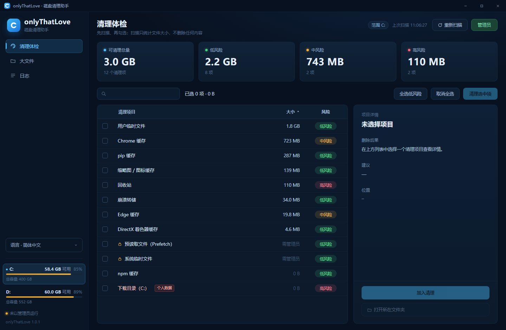

# onlyThatLove · 磁盘清理助手

<p align="center">
  
</p>

<p align="center">
  <b>点一下看清哪些垃圾能删、能腾出多少空间，再决定删不删。</b><br>
  不联网 · 无广告 · 无遥测 · 删了能还原
</p>

<p align="center">
  
  
  
  
</p>

<p align="center">
  
</p>

---

## 为什么用它

| | 常见清理软件 | onlyThatLove |
| --- | --- | --- |
| 广告 / 全家桶 | 弹广告、装别的软件 | **无广告、无附加安装** |
| 隐私 | 上传文件信息、埋点统计 | **纯本地离线，零网络请求** |
| 透明度 | 「一键加速」，删了啥不知道 | **每项列明位置、风险等级、删除后果** |
| 误删 | 删完找不回 | **全部进回收站，可还原** |
| 多盘 | 只清 C 盘 | **D 盘、外接盘同样能扫能清** |

## 下载

前往 [**Releases**](../../releases/latest) 下载，按需选择：

| 文件 | 大小 | 适合谁 |
| --- | --- | --- |
| `onlyThatLove-x.x.x-安装包.exe` | ~74 MB | 大多数用户。有安装向导、桌面快捷方式、卸载程序 |
| `onlyThatLove-x.x.x-免安装.exe` | ~74 MB | 想直接双击试用、不想装。单文件，绿色运行 |
| `onlyThatLove-x.x.x-绿色版.7z` | ~67 MB | 需要解压软件。体积最小、启动最快 |

> 免安装版与绿色版把数据保存在程序目录的 `onlyThatLove-data`，**整个文件夹拷到 U 盘即可带走配置**。安装版使用系统默认目录。

## 功能

**清理体检** — 扫描 11 类固定位置的缓存与垃圾，按「低 / 中 / 高」风险分级；点开任一项可查看位置、删除后果与建议，勾选后一键清理。

**跨盘清理** — 在每块选中的磁盘上按目录名探测额外 11 类残留：包管理器缓存、Windows 更新缓存、音乐软件缓存、Photoshop 自动恢复、下载目录、聊天记录等。**D 盘、外接盘一视同仁，不写死 C 盘。**

**大文件查找** — 选择全部磁盘或任意单盘，按阈值（≥100MB / 500MB / 1GB）列出占空间的大文件。边扫边出结果，双击定位，勾选后删除**到回收站**。

**其它** — 多语言、深色主题、自绘标题栏；左侧磁盘卡片可点击切换参与扫描的磁盘，实时显示各盘占用；操作日志记录每次扫描与清理结果。

### 清理项一览

<details>
<summary><b>固定位置（11 类）</b> — 点击展开</summary>

**用户级（无需管理员权限）**

| 项目 | 位置 | 风险 |
| --- | --- | --- |
| 用户临时文件 | `%LOCALAPPDATA%\Temp` | 低 |
| npm 缓存 | `%APPDATA%\npm-cache`（或 `.npmrc` 的 cache） | 低 |
| Chrome 缓存 | Chrome `User Data\<Profile>\Cache` 等 | 中 |
| Edge 缓存 | Edge `User Data\<Profile>\Cache` 等 | 中 |
| 崩溃转储 | `%LOCALAPPDATA%\CrashDumps`、`C:\Windows\Minidump` | 低 |
| pip 缓存 | `%LOCALAPPDATA%\pip\Cache` | 低 |
| 回收站 | 各驱动器 `$Recycle.Bin` | 高 |
| 缩略图 / 图标缓存 | `%LOCALAPPDATA%\Microsoft\Windows\Explorer\*.db` | 低 |
| DirectX 着色器缓存 | `%LOCALAPPDATA%\D3DSCache` 等 | 低 |

**系统级（需管理员权限，未提权时显示「需管理员」）**

| 项目 | 位置 | 风险 |
| --- | --- | --- |
| 预读取文件（Prefetch） | `C:\Windows\Prefetch` | 低 |
| 系统临时文件 | `C:\Windows\Temp`、`SoftwareDistribution\Download` | 低 |

</details>

<details>
<summary><b>跨盘探测规则（11 类）</b> — 点击展开</summary>

在每块选中的盘上探测以下目录，**探测到的才显示为一行**。一律按目录名精确匹配，不做通配递归。

| 项目 | 探测目录名 | 风险 |
| --- | --- | --- |
| pnpm 包缓存 | `.pnpm-store`、`pnpm-store` | 低 |
| npm 缓存 | `npm-cache`、`.npm` | 低 |
| Yarn / pip 缓存 | `Yarn`、`pip`、`uv` | 低 |
| Windows 更新下载缓存 | `WUDownloadCache`、`DeliveryOptimization` | 低 |
| OneDrive 临时目录 | `OneDriveTemp` | 中 |
| 音乐软件缓存 | `QQMusicCache`、`KuGou/Temp`、`CloudMusic/cache` | 低 |
| 损坏的依赖残留 | `node_modules.broken*` | 低 |
| Photoshop 自动恢复文件 | `PSAutoRecover` | 中 |
| 软件管家迁移文件 | `电脑管家迁移文件` | 中 |
| 下载目录 | `迅雷下载`、`BaiduNetdiskDownload`、`Downloads` 等 | 高 |
| 聊天软件数据 | `WeChat`、`Weixin`、`xwechat_files`、`Tencent Files` | 高 |

> 「下载目录」与「聊天软件数据」标记为**个人数据**，只会列出，必须勾选并二次确认后才会移入回收站。

</details>

## 安全边界

这些是代码里的硬性约束，不是宣传语：

- 删除只作用于上述**固定路径或按目录名精确匹配**，不做通配删除
- 浏览器缓存只删 `Cache` / `Code Cache` / `GPUCache` 等，**不动登录态与书签**
- 删除失败（文件占用 / 无权限）逐文件跳过，不中断整批操作
- 高风险与系统级项目清理前**二次确认**；个人数据项额外弹出醒目警告
- 大文件删除一律走系统回收站；回收站不可用（网络盘 / 策略禁用）时**报错跳过，绝不永久删除**
- 大文件视图**只删文件、拒绝删目录**，避免误删整棵目录树
- **纯本地运行**：无网络请求，无遥测，不上传任何数据

## 从源码运行

```bash
npm install
npm start            # 开发模式运行
npm run pack         # 打包为免安装目录
npm run dist         # 生成安装包
```

构建产物输出到 `dist/`，打包配置见 `electron-builder.yml`。

## 技术细节

<details>
<summary>回收站扫描为什么不走 Shell API</summary>

`SHQueryRecycleBin` 在 19 万项时需要约 70 秒，遍历 Shell 命名空间更慢。改为直接解析 NTFS 的 `$Recycle.Bin\<SID>\$I*` 记录：

- 每条 `$I` 文件前 16 字节中，`[8..16)` 为原文件大小（`$R` 记录的是压缩后占用，与资源管理器显示不一致）
- 64 路并发打开，实测约 0.145 ms/文件；并发超过 128 反而劣化
- 当前用户 SID 的目录优先，其他用户目录通常无权读取，直接跳过
- 系统清理（Storage Sense）可能在扫描期间删除记录，此时按 `ENOENT` 跳过

</details>

<details>
<summary>管理员权限为什么不用管理员组 SID 判断</summary>

依据令牌完整性级别 `S-1-16-12288`（High）判断，而不是管理员组 SID —— 未提权时管理员组 SID 会以 deny-only 形式出现在 `whoami /groups` 里，用它判断会误报。

提权也不用 `app.relaunch`（不足以保证 UAC 弹窗），而是 PowerShell `Start-Process -Verb RunAs`。

</details>

<details>
<summary>大文件扫描的性能取舍</summary>

Windows 的 `Dirent` 不返回文件大小，每个文件都要额外 `stat`，全盘 80 万文件时这是主要耗时。

- `stat` 用全局信号量限流（512 路）。不限流时峰值可达 10 万并发，libuv 队列雪崩，实测慢 10 倍以上
- 多个起始目录并行遍历，共享同一份 `stat` 名额
- 按目录名跳过**包管理缓存**（`npm-cache`、`_cacache`、`Yarn`、`pnpm-cache`、`.gradle`、`.m2` 等）与 **IDE 扩展目录**（`.vscode`、`.trae-cn`、`.windsurf`、`.cursor`、`extensions`）。实测这两类占八成耗时，内容都是可重新下载的包副本 / 可重装的插件资源
- **不跳过** JetBrains `caches`、浏览器 `Cache` —— 这些目录里存在 GB 级真实文件

本机（80 万文件、SSD）实测：不加跳过约 110–170 秒，加跳过约 50 秒，命中结果不变。

</details>

<details>
<summary>目录结构</summary>

```
src/
  main/
    main.js      主进程：窗口、IPC、提权、大文件扫描
    preload.js   contextBridge 白名单桥接
    scanners.js  清理项与跨盘规则的定义、扫描与清理
    winutil.js   目录遍历、删除、回收站、磁盘、权限
  renderer/
    index.html   页面结构
    styles.css   深色主题
    app.js       渲染逻辑
```

</details>

## 许可证

[MIT](LICENSE) © 2026 onlyThatLove